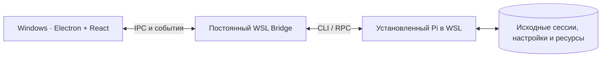

# Pi WSL Desktop

Лёгкий Windows-клиент для существующего [Pi Coding Agent](https://github.com/earendil-works/pi) в WSL. Проекты, сессии, чат, Skills, Extensions и MCP доступны из одного окна. Исполнение Pi, его история и конфигурация остаются в выбранном WSL-дистрибутиве.

**Состояние на 26 октября 2026 года:** базовые возможности M0–M3 приняты и слиты. Выпуск 1.0 продолжается: установщик и технический пакет UI-A уже в `main`, перенос утверждённого Design Lab в Electron проходит отдельную приёмку в [Draft PR #24](https://github.com/triagmas/pi-wsl-desktop/pull/24). Версия пакета — `1.0.0-rc.1`; стабильный релиз ещё не объявлен. Текущий шаг и оставшиеся ограничения — в [ROADMAP.md](ROADMAP.md).

## Что умеет клиент

- Обнаруживает установленный Pi в WSL, показывает состояние подключения и диагностику.
- Находит проекты и сессии Pi, читает историю и позволяет продолжить диалог через официальный Pi RPC.
- Показывает поток ответов и события инструментов, поддерживает отмену.
- Управляет ресурсами Pi: Skills, пакетами/Extensions и конфигурацией MCP с предпросмотром, подтверждением и откатом изменений.
- Поддерживает декларативные модули, темы и независимые настройки шрифтов.

Приёмка отдельных пакетов имеет оговорки: настоящий терминал WSL и метрики Windows ещё впереди, OAuth login/logout не выведен в GUI, полный реальный цикл отправки и проверка установленной сборки остаются в плане 1.0. [Подробности и отдельные задачи](ROADMAP.md#известные-ограничения-и-отдельные-задачи).

## Документация

| Для кого | Документ |
|:--|:--|
| Пользователь и участник проекта | [ROADMAP.md](ROADMAP.md) — что готово, что делаем сейчас и что осталось до 1.0 |
| Разработчик | [CONTRIBUTING.md](CONTRIBUTING.md) — окружение, запуск, проверки и подготовка изменений |
| Продуктовая и техническая работа | [PRODUCT.md](PRODUCT.md) — сценарии и границы; [SPECIFICATION.md](SPECIFICATION.md) — архитектура и контракты |
| Работа с внешним видом | [Design Lab](design-lab/README.md) — утверждённые компоненты, композиция и демонстрационный просмотр |
| AI-агент | [AGENTS.md](AGENTS.md) — постоянные правила и каталог проектных Skills |
| Дополнительные сведения | [Упаковка Windows](docs/release/m4-r01-packaging.md), [лицензия MIT](LICENSE), [лицензии зависимостей](THIRD_PARTY_NOTICES.md) |

## Как это работает

Клиент использует ту же установку Pi, что и CLI. Для просмотра истории не создаётся Windows-копия сессий; операции записи выполняются после явного действия и подтверждения.

## Разработка и проверка интерфейса

Целевая среда — Windows 11 x64 + WSL2 Ubuntu, Node.js от 22.13.0 и существующий Pi в WSL. Запуск из исходников и команды проверок описаны в [CONTRIBUTING.md](CONTRIBUTING.md).

Внешний вид переносится из уже утверждённого Design Lab. Его демонстрационные данные не подтверждают работу Pi, а успешные технические тесты не означают визуальную приёмку настоящего Windows-окна. [Текущее задание владельца](https://github.com/triagmas/pi-wsl-desktop/issues/21#issuecomment-6410056356).

[Repository Contract](.github/workflows/repository-contract.yml) проверяет документацию и ограничения публичного репозитория; [Product CI](.github/workflows/product-ci.yml) — код, сборку и автоматические сценарии на Linux/Windows. Реальная проверка Windows+WSL и решение владельца о приёмке учитываются отдельно.

## Границы проекта

Это независимый клиент, не официальное приложение Pi. На старте код `justhil/pi-app` не используется. Проект не зависит от VoiceForge, ChatWake или Hermes и не включает собственный движок моделей, IDE, Git Review, голосовые функции, мобильный клиент или собственный MCP-клиент. [Полные границы продукта](PRODUCT.md#4-что-не-делаем).
