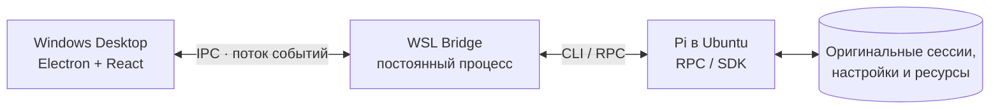

# Pi WSL Desktop

> **Лёгкий Windows-клиент для существующего Pi Coding Agent внутри WSL.**
>
> Одно окно для проектов, чатов, сессий, Skills, Extensions и MCP. Без собственной реализации Pi, копирования сессий или второй конфигурации.

**Текущий статус:** M0–M3 приняты и слиты; UI-A, UI21 и UI-B в `main`. Версия пакета — `1.0.0` (подготовка релиза); тег `v1.0.0`, GitHub Release и установщик публично не выпущены. Реальная генерация, streaming и Stop подтверждены на реальном провайдере (2 API-обращения); установка финального установщика в пользовательский профиль — **NOT RUN**. Актуальная приёмка — [ROADMAP.md](ROADMAP.md), состояние релиза — [1.0.0-release-notes.md](docs/release/1.0.0-release-notes.md).

## Документация

| Документ | Назначение |
|:--|:--|
| 📘 **[PRODUCT.md](PRODUCT.md)** | Продукт, пользовательские сценарии, границы и этапы M0–M4 |
| 🗺️ **[ROADMAP.md](ROADMAP.md)** | **Актуальный прогресс:** чекбоксы задач, статусы, принятые PR, история выполнения |
| 🛠️ **[SPECIFICATION.md](SPECIFICATION.md)** | Архитектура, контракты Windows ↔ WSL, интеграция с Pi, критерии приёмки |
| 🤖 **[AGENTS.md](AGENTS.md)** | Правила Pi, применимые Skills, TDD, выбор усилия модели, отчёты и ревью |
| 💸 **[TOKEN_EFFICIENCY.md](docs/TOKEN_EFFICIENCY.md)** | Экономия токенов Pi: модели/effort, компактный контекст, измерения, границы безопасности |
| ⚖️ **[LICENSE](LICENSE)** | Лицензия собственного кода |
| 📝 **[1.0.0 release notes](docs/release/1.0.0-release-notes.md)** | Что входит в 1.0, требования, известные ограничения |
| 📦 **[Установка и откат](docs/release/1.0.0-install-rollback.md)** | Установка, обновление, удаление и пошаговый rollback для пользователя |
| ✅ **[Acceptance checklist 1.0.0](docs/release/1.0.0-acceptance-checklist.md)** | Доказательства проверок и незакрытые гейты |
| 📄 **[THIRD_PARTY_NOTICES.md](THIRD_PARTY_NOTICES.md)** | Сторонние компоненты и их лицензии (включая Electron/Chromium) |

## Принцип работы

Windows-клиент — **интерфейс**. Исполнение Pi, Skills, Extensions и MCP остаётся **внутри выбранного WSL-дистрибутива**.

## Roadmap

| Этап | Результат |
|:--|:--|
| **M0 — Foundation & WSL Bridge** | Надёжное подключение к установленному Pi и диагностика |
| **M1 — Sessions & Chat** | История всех обнаруженных проектов, чтение и продолжение сессий |
| **M2 — Pi Manager** | Управление Skills, Extensions, MCP и настройками внутри WSL |
| **M3 — Module System** | Версионированные интерфейсы модулей и подключаемые панели |
| **M4 — Desktop 1.0** | Стабилизация, Windows-сборка, тесты, выпуск |

**Актуальные статусы каждого этапа, все выполненные задачи и доказательства:** [ROADMAP.md](ROADMAP.md). Структура этапов — в [PRODUCT.md](PRODUCT.md#7-дорожная-карта). Реализация ведётся **крупными тематическими PR**, проходит TDD, Vitest/React Testing Library/Zod, Playwright/Electron и отдельную реальную Windows+WSL-приёмку.

## Границы проекта

- **Не является** официальным приложением Pi Coding Agent.
- Не использует код `justhil/pi-app` на старте — это независимая реализация GUI; технические идеи не подразумевают копирования исходников.
- Не зависит от VoiceForge, Hermes или ChatWake.
- Не включает встроенную IDE, голосовые функции, Git Review, мобильный клиент и собственный MCP-клиент.

## Установка (для пользователей)

**Требования:** Windows 10/11 x64; WSL2 с хотя бы одним дистрибутивом (проверено на Ubuntu); установленный Pi Coding Agent внутри этого дистрибутива; `python3` в дистрибутиве для терминала.

1. Скачать установщик `PiWSLDesktop-<версия>-setup.exe` и сверить SHA-256 с опубликованным в релизе.
2. Запустить — установка per-user, без прав администратора; приложение ставится в `%LOCALAPPDATA%\Programs\pi-wsl-desktop` и само не запускается.
3. Запустить из меню «Пуск» и дождаться подключения к WSL и Pi в левой панели.
4. Обновление — установка более нового установщика поверх; удаление — через «Параметры → Приложения». Данные пользователя в `%APPDATA%\pi-wsl-desktop` при удалении сохраняются.

Установщик не подписан (SmartScreen может предупредить) и не содержит автоматического обновления. Пошаговые инструкции, удаление следов и **rollback** — в [docs/release/1.0.0-install-rollback.md](docs/release/1.0.0-install-rollback.md); ограничения версии — в [release notes](docs/release/1.0.0-release-notes.md#known-limitations-in-100).

**Границы записи:** чтение проектов, сессий и истории ничего не меняет. Операции Resource Manager (Skills, пакеты/Extensions, MCP) изменяют файлы Pi только после явного подтверждения пользователя, с резервной копией и откатом: приложение не является «только для чтения» по построению, и это отражено в предпросмотре перед каждым применением.

## Процесс разработки

**Pi** разрабатывает и применяет все доступные **релевантные Skills**, **независимый ревьюер** проверяет PR, **владелец продукта** утверждает merge. Для снижения токенов действуют [профили сложности и протокол измерений](docs/TOKEN_EFFICIENCY.md); `AGENTS.md` не меняет автоматически уровень модели. Каждый принятый результат отмечается в `ROADMAP.md` с GitHub-доказательством; несогласованный прогресс блокирует принятие PR. Авторитетные решения закрепляются в корневых MD-документах и GitHub Issues.

**Публичный GitHub:** два уровня проверки. [Repository Contract CI](.github/workflows/repository-contract.yml) — только документация и правила учёта (принят в PR #3). [Product CI](.github/workflows/product-ci.yml) — реальные `typecheck` / `lint` / Vitest (unit, contract, integration, UI) / сборка / Playwright Electron E2E на стандартных бесплатных `ubuntu-latest` и `windows-latest` без секретов. Реальный Windows+WSL smoke остаётся отдельным ручным гейтом и никогда не подменяется зелёным CI.

**M0–M3 приняты, UI-пакеты и UI-B в `main`.** Оригинальные Pi-сессии остаются по месту; просмотр истории read-only, Pi RPC resume только по действию пользователя. **M2** добавил менеджер Skills, Packages/Extensions, MCP и подтверждаемые операции с резервными копиями; операции записи выполняются только после подтверждения пользователя. Реальная запись в пользовательскую `~/.pi` без явного подтверждения не выполняется; границы и остаточные риски — [#9](https://github.com/triagmas/pi-wsl-desktop/issues/9). Для M3 см. [Issue #10](https://github.com/triagmas/pi-wsl-desktop/issues/10), для отложенных UX-замечаний 1.0 — [#37](https://github.com/triagmas/pi-wsl-desktop/issues/37), [#38](https://github.com/triagmas/pi-wsl-desktop/issues/38), [#40](https://github.com/triagmas/pi-wsl-desktop/issues/40), [#41](https://github.com/triagmas/pi-wsl-desktop/issues/41).

---

**Технологии:** Windows 11 · WSL2 · Ubuntu · Node.js / TypeScript · Electron / React · Pi CLI RPC / SDK. Лицензия собственного кода — MIT, сторонние компоненты — в [THIRD_PARTY_NOTICES.md](THIRD_PARTY_NOTICES.md).