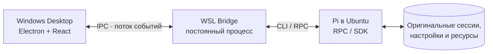

# Pi WSL Desktop

> **Лёгкий Windows-клиент для существующего Pi Coding Agent внутри WSL.**
>
> Одно окно для проектов, чатов, сессий, Skills, Extensions и MCP. Без собственной реализации Pi, копирования сессий или второй конфигурации.

**Текущий статус:** M0 принят — [PR #4](https://github.com/triagmas/pi-wsl-desktop/pull/4) merged (`main` `1c24cf23`) · M1 Sessions & Chat реализован и предъявлен на ревью ([Issue #5](https://github.com/triagmas/pi-wsl-desktop/issues/5) · [PR #6](https://github.com/triagmas/pi-wsl-desktop/pull/6)) · `v0.1` · актуальные статусы и выполненные задачи — в [ROADMAP.md](ROADMAP.md).

## Документация

| Документ | Назначение |
|:--|:--|
| 📘 **[PRODUCT.md](PRODUCT.md)** | Продукт, пользовательские сценарии, границы и этапы M0–M4 |
| 🗺️ **[ROADMAP.md](ROADMAP.md)** | **Актуальный прогресс:** чекбоксы задач, статусы, принятые PR, история выполнения |
| 🛠️ **[SPECIFICATION.md](SPECIFICATION.md)** | Архитектура, контракты Windows ↔ WSL, интеграция с Pi, критерии приёмки |
| 🤖 **[AGENTS.md](AGENTS.md)** | Правила Pi, **все доступные применимые Skills**, TDD, отчёты и ревью |
| ⚖️ **[LICENSE](LICENSE)** | Лицензия собственного кода |

## Принцип работы

Windows-клиент — **интерфейс**. Исполнение Pi, Skills, Extensions и MCP остаётся **внутри выбранного WSL-дистрибутива**.

## Roadmap

| Этап | Результат |
|:--|:--|
| **M0 — Foundation & WSL Bridge** | Надёжное подключение к установленному Pi и диагностика |
| **M1 — Sessions & Chat** | История всех обнаруженных проектов, чтение и продолжение сессий |
| **M2 — Pi Manager** | Управление Skills, Extensions, MCP и настройками внутри WSL |
| **M3 — Module System** | Версионированные интерфейсы модулей и подключаемые панели |
| **M4 — Desktop 1.0** | Стабилизация, Windows-сборка, тесты, выпуск |

**Актуальные статусы каждого этапа, все выполненные задачи и доказательства:** [ROADMAP.md](ROADMAP.md). Структура этапов — в [PRODUCT.md](PRODUCT.md#7-дорожная-карта). Реализация ведётся **крупными тематическими PR**, проходит TDD, Vitest/React Testing Library/Zod, Playwright/Electron и отдельную реальную Windows+WSL-приёмку.

## Границы проекта

- **Не является** официальным приложением Pi Coding Agent.
- Не использует код `justhil/pi-app` на старте — это независимая реализация GUI; технические идеи не подразумевают копирования исходников.
- Не зависит от VoiceForge, Hermes или ChatWake.
- Не включает встроенную IDE, голосовые функции, Git Review, мобильный клиент и собственный MCP-клиент.

## Процесс разработки

**Pi** разрабатывает и применяет все доступные **релевантные Skills**, **независимый ревьюер** проверяет PR, **владелец продукта** утверждает merge. Каждый принятый результат отмечается в `ROADMAP.md` с GitHub-доказательством; несогласованный прогресс блокирует принятие PR. Авторитетные решения закрепляются в корневых MD-документах и GitHub Issues.

**Публичный GitHub:** два уровня проверки. [Repository Contract CI](.github/workflows/repository-contract.yml) — только документация и правила учёта (принят в PR #3). [Product CI](.github/workflows/product-ci.yml) — реальные `typecheck` / `lint` / Vitest (unit, contract, integration, UI) / сборка / Playwright Electron E2E на стандартных бесплатных `ubuntu-latest` и `windows-latest` без секретов. Реальный Windows+WSL smoke остаётся отдельным ручным гейтом и никогда не подменяется зелёным CI.

**M0 принят.** В M1 работа с существующими Pi-сессиями начинается только с безопасного чтения; история CLI Pi остаётся по месту и не мигрирует. Продолжение истории через Pi RPC допускается после тестирования контрактов и явного действия пользователя.

---

**Технологии (план):** Windows 11 · WSL2 · Ubuntu · Node.js / TypeScript · Electron / React · Pi CLI RPC / SDK.