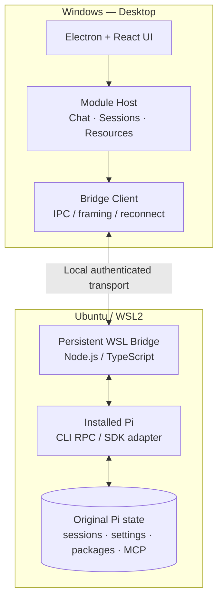

# Pi WSL Desktop — техническая спецификация

> **Единый контракт реализации, интеграции и приёмки.**  
> Спецификация описывает собственный лёгкий Windows-клиент, который использует существующий Pi внутри WSL, а не заменяет его.

**Статус:** Engineering Specification · Draft v0.1  
**Приоритет:** корректность сессий → надёжность WSL → управление ресурсами → расширяемость  
**Связанные документы:** [PRODUCT.md](PRODUCT.md) · [Roadmap](PRODUCT.md#7-дорожная-карта)

---

## 1. Область действия

**Целевая конфигурация:** Windows 11 x64, WSL2, Ubuntu 26.04 LTS, установленный пользователем Pi и Node.js. Остальные WSL-дистрибутивы допускаются после проверки, не должны жёстко кодироваться в ядре.

**Приоритет совместимости:** текущая установка Pi и её версии, а не версия SDK, встроенная в сторонний GUI. Pi CLI и GUI должны работать с одним агентным каталогом и одними сессиями.

**Рабочая директория разработки:** отдельный репозиторий на `F:\_hermes\CODE\pi-wsl-desktop` (Linux-представление `/mnt/f/_hermes/CODE/pi-wsl-desktop`). Не создавать копии репозитория разработки на `C:` или `E:`. Это правило не запрещает стандартные пользовательские/системные каталоги приложений Windows.

## 2. Архитектура

### 2.1 Разделение ответственности

| Компонент | Отвечает за | Не должен делать |
|:--|:--|:--|
| **Desktop Shell** | Окно, навигация, визуализация, диалоги подтверждения | Исполнять Pi-пакеты и MCP-серверы на Windows |
| **Module Host** | Регистрация UI-модулей, capabilities, жизненный цикл | Читать секреты других модулей напрямую |
| **Bridge Client** | Соединение, корреляция запросов, потоки, тайм-ауты | Интерпретировать файлы сессий как собственную БД |
| **WSL Bridge** | Управление Pi, ресурсами, процессами, правами | Хранить параллельную копию конфигурации Pi |
| **Pi** | Сессии, модели, инструменты, пакеты, MCP | Зависеть от присутствия Desktop |

### 2.2 Транспорт и жизненный цикл

**M0 — базовый вариант:** один долгоживущий WSL Bridge, запускаемый из Windows через `wsl.exe -d <distro> --exec ...` без пересылки многострочных shell-скриптов при каждом запросе. Клиент и процесс обмениваются типизированными JSON-сообщениями с явным разделением кадров; потоковые события идут по тому же каналу или логически отдельному потоку.

Не использовать повторные краткоживущие вызовы `wsl.exe` для каждого события чата/пакета/ресурса. Не предполагать, что Node.js находится в `/usr/bin`: путь и переменные среды определяются безопасным bootstrap или явной настройкой. При зависании bootstrap — ограничение времени и понятная ошибка, а не бесконечное ожидание.

**Возможная оптимизация после M0:** защищённый локальный WebSocket/HTTP, если это действительно упрощает переподключение или многоклиентность. Никакого открытого сетевого API по умолчанию.

**Обязательные свойства транспорта:**

- request ID и привязка всех ответов к запросу; типизированные версии контрактов;
- корректное разделение `stdout` протокола и диагностического `stderr`;
- событие heartbeat/health, ограничение времени bootstrap и операций;
- обработка отключения, переподключения и отмены без дублирования действия;
- перезапуск GUI не должен уничтожать историю Pi;
- операции записи не повторяются автоматически после неопределённого результата без проверки идемпотентности.

## 3. Интеграция с Pi

### 3.1 CLI RPC и SDK

В первой итерации использовать **официальный Pi RPC Mode** для диалогов, состояния и событий. Если отдельные функции недоступны через RPC, реализовать ограниченный адаптер к Pi SDK внутри WSL Bridge. Не поддерживать независимую реализацию агентного цикла или формата сессий.

Схемы Pi RPC сверяются с **установленной версией**. Перед разработкой M0 фиксируются вывод `pi --version`, обнаруженные команды и поддерживаемые интерфейсы; не полагаться на устаревшие примеры внешних клиентов.

### 3.2 Источники данных

| Ресурс | Авторитетный источник |
|:--|:--|
| Сессии | Pi SessionManager / исходные JSONL Pi, обычно `~/.pi/agent/sessions/` |
| Пользовательские настройки | Активный Pi agent directory, обычно `~/.pi/agent/` |
| Проектные ресурсы | Pi-совместимые `.pi/` в открытом проекте |
| Skills и Extensions | Эффективные ресурсы Pi (включая пакеты и пути, настроенные пользователем) |
| MCP | Встроенная подсистема Pi; обычно `~/.pi/agent/mcp.json` и доверенный `<project>/.pi/mcp.json` |

Нужно поддерживать `PI_CODING_AGENT_DIR`, настройки другого каталога сессий (`PI_CODING_AGENT_SESSION_DIR`, `sessionDir`, `--session-dir`, где применимо) и версионные различия Pi. Сканирование файлов допускается для **индекса чтения**, но запись формата Pi должна выполняться через поддерживаемые API/CLI.

### 3.3 Совместимость с одновременно открытым CLI

- Чтение сессий допускается без вмешательства в активный CLI.
- Одна и та же сессия не должна одновременно изменяться GUI и CLI без явной политики конкурентного доступа.
- В M1 минимально необходимы обнаружение активной сессии и безопасное предложение открыть её только для чтения или переключиться на CLI.
- Конфликт, неполная запись JSONL, перемещение каталога и отсутствие доступа отражаются в интерфейсе как понятные состояния.

## 4. Функциональные контракты

### 4.1 Sessions (M1)

- `listProjects`: индекс всех найденных каталогов проектов, а не только текущего CWD.
- `listSessions`: список сессий с исходным местоположением, проектом, названием, временем, доступностью и состоянием.
- `readSession`: чтение структуры и сообщений без изменения JSONL.
- `openSession`: запуск Pi с нужным CWD и правильным исходным session ID/path.
- `sendPrompt`, `interrupt`, `getState`, `subscribeEvents`: действия и потоковые события Pi.
- `searchSessions`: поиск по доступным метаданным и, если явно включено, содержимому.

**Названия выше — контракт нашего Bridge, не утверждение о буквальных названиях команд Pi RPC.** Bridge переводит их в поддерживаемый Pi API.

### 4.2 Skills (M2)

- Инвентаризация с указанием источника: пользователь, проект, установленный пакет, иной путь.
- Чтение описания и `SKILL.md` в режиме без записи.
- Включение/отключение только средствами поддерживаемых настроек Pi; не изменять произвольно чужие исходники.
- Установка, удаление и обновление пакетов через поддерживаемые механизмы Pi; отдельное подтверждение, проверка источника, отображение фактической команды и результата.
- Перезагрузка ресурсов только в безопасной точке; если Pi занят — сообщение и отложенное действие по согласованию.

### 4.3 Extensions / Packages (M2)

- Список пакетов, TypeScript Extensions, версий и обнаруженных инструментов/команд.
- Корректное различение «установлено», «включено», «загружено в конкретную сессию» и «ошибка загрузки».
- Управление источниками npm, Git и локальными каталогами с проверкой происхождения.
- Возможность отключить конфликтующее расширение без удаления его файлов.
- Совместимость GUI с расширениями оценивается отдельно от работоспособности расширения в CLI (не всякий TUI-диалог автоматически поддерживается GUI).

### 4.4 MCP (M2)

- Работа через актуальную **встроенную MCP-подсистему Pi**, а не второй MCP-клиент в Windows.
- Просмотр глобальных и проектных серверов, состояния, транспорта и доступных инструментов.
- Создание/изменение/удаление конфигураций с подтверждением, сохранением неизвестных ключей и атомарной записью, где применимо.
- Проверка соединения, ошибки запуска и OAuth через предусмотренные Pi операции.
- Уважение trust-gate проектных конфигураций.
- Диагностика конфликтов: некоторые расширения переопределяют встроенную команду `/mcp` и тем самым меняют поведение MCP в текущей сессии.

## 5. Модульная система (границы с M0, динамика с M3)

Каждый модуль объявляет: `id`, `version`, `apiVersion`, точки входа UI, capabilities, зависимости и параметры. Ядро предоставляет контролируемые сервисы `sessions`, `runtime`, `resources`, `notifications`, `settings`.

**M0–M2:** статически подключаемые внутренние модули через единые интерфейсы (проще тестировать). **M3:** внешние декларативные модули, регистрация экранов/действий/панелей, версионирование интерфейсов и включение/отключение.

Динамический запуск произвольного JavaScript из непроверенных каталогов в Electron Renderer или Main **не является обязательной частью 1.0**. Исполняемые модули требуют отдельной модели изоляции и разрешений.

## 6. Безопасность и данные

| Требование | Контроль |
|:--|:--|
| Без двойной конфигурации | Настройки Pi остаются в WSL; Windows хранит только UI-предпочтения и ссылку на дистрибутив. |
| Безопасное чтение | Открытие диалога/Skill/MCP не модифицирует исходные файлы. |
| Защита от потери данных | Для изменений ресурсов: валидация, предпросмотр, сохранение неизвестных полей, backup/rollback там, где применимо. |
| Секреты | Не писать токены и ключи в логи, telemetry, Issues, скриншоты и публичный Git. |
| Доступ | Локальный пользователь и подтверждённые проекты; никаких публичных listening-сокетов. |
| Расширения | Инсталляция и исполнение сторонних пакетов считаются потенциально опасными; подтверждение перед выполнением. |
| Проектные MCP | Подключать только с учётом модели доверия Pi. |

## 7. Необходимые интерфейсы и отказоустойчивость

Протокол Bridge версионируется; для ошибок определяются стабильные коды как минимум `WSL_UNAVAILABLE`, `NODE_NOT_FOUND`, `PI_NOT_FOUND`, `PI_INCOMPATIBLE`, `BRIDGE_TIMEOUT`, `SESSION_CONFLICT`, `UNTRUSTED_PROJECT`, `RESOURCE_BUSY`, `MCP_ERROR`.

В GUI каждая ошибка сопровождается диагностикой: источник, затронутый дистрибутив/проект, безопасное действие для восстановления. Запрещены бесконечные индикаторы загрузки без тайм-аута и невозможность отмены зависшего действия.

## 8. Тестирование и критерии приёмки

**Обязательная стратегия:** TDD для бизнес-логики, контрактные тесты Bridge↔Desktop, фикстуры реальных форматов Pi и smoke на Windows + WSL2. Изолированные тесты не заменяют проверку настоящей Ubuntu.

| Этап | Минимальные проверяемые результаты |
|:--|:--|
| **M0** | Автообнаружение Ubuntu; запуск/останов Bridge; `health`; потеря соединения; ошибки тайм-аута; отсутствие запуска Pi в Windows. |
| **M1** | Индексация сессий разных CWD; чтение старой сессии; продолжение; поток/interrupt; отсутствие изменений при просмотре; конфликт с CLI. |
| **M2** | Инвентаризация ресурсов; установка/отключение; WSL CLI видит изменения; проверка статуса MCP и trust-gate; не повреждаются пользовательские настройки. |
| **M3** | Регистрация модуля, capabilities, отключение, несовместимая версия, ошибка модуля без падения GUI. |
| **M4** | Чистая установка Windows, запуск на действующем WSL, регрессионная матрица, README, LICENSE, отсутствие секретов, сборка EXE. |

### Общие требования к PR

- [ ] Связан с макроэтапом и Issue; понятно, **что изменено и почему**.
- [ ] Присутствуют отрицательные тесты и демонстрация хотя бы одного сбоя до исправления (где применимо).
- [ ] Приведены точные команды запуска тестов и их результаты.
- [ ] Указаны файлы и статистика diff: **добавлено/удалено строк**.
- [ ] Есть проверка отсутствия модификации существующих сессий при read-only действиях.
- [ ] CI и реальный Windows+WSL smoke отмечены отдельно; недоступные проверки не объявляются выполненными.
- [ ] Review: `ACCEPT` / `CHANGES REQUIRED` / `BLOCKED`; merge — только после утверждения владельца продукта.

## 9. Порядок реализации

1. **M0 — доказать транспорт**: согласовать RPC/SDK контракт на установленном Pi, поднять один WSL Bridge и получить health/state. UI минимален.
2. **M1 — доказать совместимость сессий**: получить полный индекс, открыть историю, продолжить реальную сессию.
3. **M2 — доказать сквозное управление ресурсами**: изменить ресурсы через GUI и подтвердить эффект в Pi CLI.
4. **M3 — стабилизировать расширяемость**: формальный API Desktop Modules и контрактные тесты.
5. **M4 — закончить продукт**: инсталлятор, диагностика, регрессионные испытания, публичный релиз.

**Нельзя переходить к следующему этапу, пока не принят критерий предыдущего.** Исключения документируются отдельным решением в GitHub.

---

### Технические источники

- [Pi: RPC Mode](https://github.com/earendil-works/pi/blob/main/packages/coding-agent/docs/rpc.md)
- [Pi: Sessions and Context](https://github.com/earendil-works/pi/blob/main/packages/coding-agent/docs/sessions.md)
- [Pi: Pi Packages](https://github.com/earendil-works/pi/blob/main/packages/coding-agent/docs/packages.md)
- [Pi: MCP Servers](https://github.com/earendil-works/pi/blob/main/packages/coding-agent/docs/mcp.md)
- [Продуктовый контракт](PRODUCT.md)